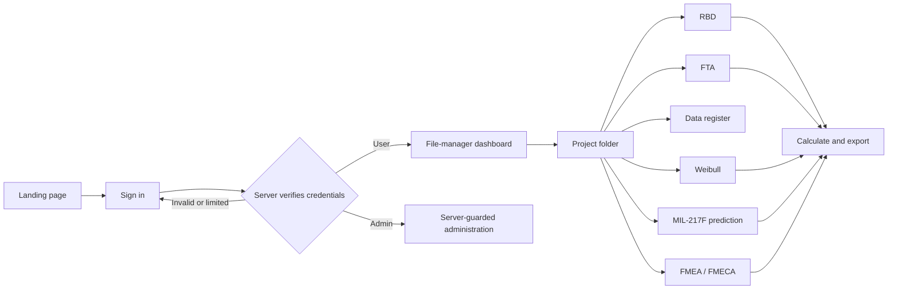
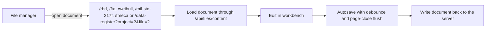

# Application flow



The Next.js `/api/*` route handler fulfils every request. Login verifies the password against
the server directory, sets a signed HttpOnly session cookie and returns the account. The
dashboard requests the signed-in account's tree; the API derives ownership from the cookie
and ignores browser-supplied ownership values. Creating a project creates a project folder;
documents are created explicitly from the file manager. Opening modules and changing
security-relevant state writes a server audit event.

The dashboard is a file manager over the account's server-stored `project/` tree, rendered
as an expandable tree. Folder navigation, search, create project, create folder, create
document, rename and delete all call the file API and re-read the record, so the list always
reflects the files the workbenches save. Creation and renaming happen inline in the row, as
in Windows Explorer: the entry is created with a unique default name, the name becomes an
editable field, `Enter` or blur commits and `Escape` cancels. The row context menu offers
Open, Rename, a **New** submenu and Delete; the `F2` and `Delete` keys do the same.



Opening a document carries its account-relative path in the URL. The editor hydrates from
that server file, keeps module state in memory, and writes changes back to the same path.
Deleting or renaming the file in the manager changes what the URL resolves to; remembered
save locations are cleared or updated at the same time.

Every analysis module loads its component list from the project Data Register through
`loadProjectRegister`. Project files are plain folders, so the bridge lists the project and
picks the register document wherever the user created it.

The account menu opens **Profile** (`/profile`), which shows the account details and lets the
user change the display name and optionally upload, replace or remove a PNG, JPEG or WebP
photo. The photo control sits on the avatar itself as an edit badge. Without a photo the
account sees a bundled line-art avatar on both the profile page and the header; bundled
illustrations are mirrored to face left, uploaded photos are not.

RBD/FTA selection shows editable component data before calculation. Calculate replaces the
inspector with result values; explanation remains a separate result action. Exports include
the scaled diagram, calculation table and block-by-block explanation.

Logout clears the session cookie and returns to login. Expired or missing sessions receive
401 from the API.

## Admin flow

```mermaid
flowchart TD
  A[/admin] --> B[Page verifies the server session]
  B -->|Not signed in| C[/login]
  B -->|Not admin| D[/dashboard]
  B -->|Admin| E[List users from /api/admin/users]
  E --> F[Create user]
  F --> G[API validates, hashes password, updates the account directory]
  E --> H[Remove user]
  H --> I[API blocks self and built-in accounts]
```

Accounts and files survive reloads and redeploys because they live on the server. They follow
the person to any browser or device that signs in with the same account.
